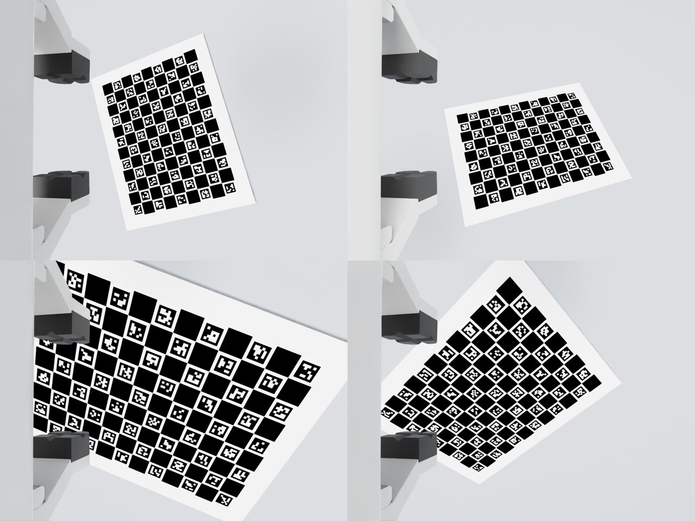

# Camera_franka_calibration

**用腕部相机 + 标定板，标定 Franka Panda 各关节的"扭曲"（几何误差）和"形变"（关节柔性），并在 IK 中补偿。**

机械臂用久了，关节附近的连接件会扭转、偏移，负载下关节也会弹性变形。这时用标称 URDF 做 FK / IK，实际到达位置和预设位置就会对不上。本项目只需要一台装在手腕上的相机，加一块固定在桌面的标定板，就能把这些误差标出来，并给出补偿后的模型。

仿真里给 Franka 注入了已知误差，相机朝夹爪倾斜 10°，夹爪挡住约 18% 的画面。"看到目标 → IK → 实际到达"的闭环误差如下：

| 模型 | 留出视角重投影 | 闭环到达误差（60 次） |
|---|---:|---:|
| 标称 URDF + 手眼标定 | 3.48 px | 平均 5.03 mm，最大 8.2 mm |
| + 几何误差补偿 | 1.16 px | 平均 1.48 mm，最大 4.8 mm |
| + 几何误差 + 关节柔性补偿 | **0.14 px** | **平均 0.39 mm，最大 0.50 mm** |



详细数据见 [仿真验证报告](reports/sim_report.md)。

---

## 原理

| 内容 | 模型 |
|---|---|
| 关节扭曲 / 偏移 | 每个关节原点后接一个 6 自由度刚体误差 `E_i`（3 平移 + 3 旋转，含零位偏置）：`T_i = O_i · E_i · Rz(q_i)`；法兰同样有一个 |
| 关节形变 | 线性扭簧：`q_link = q_encoder − c_i · τ_i`，`τ` 为实测关节力矩（Franka `tau_J`），`c_i = 1/K_i` |
| 手眼外参 | 相机相对 `panda_hand` 的 6 自由度位姿 |
| 其他 | 标定板在基座系的位姿；相机内参 + Brown-Conrady 畸变 |

- **残差**：所有参数一起用 Levenberg–Marquardt 联合优化，残差是标定板角点的重投影误差（像素），使用 Huber 鲁棒损失。
- **可辨识性**：程序自动做可辨识性分析，用逐列 Gram–Schmidt 剔除冗余参数，剩下完备、最小的 4R+6 = 34 个几何参数。冗余来自三处：
  - 基座误差被标定板位姿吸收，法兰误差被手眼外参吸收。
  - 每个关节沿/绕自身轴的误差，会转移到下一个关节。
  - 没有被激励的柔度，比如关节 1 轴竖直、关节 7 几乎不受力，也会被固定。

  被固定的参数都列在结果文件里。
- **初始化**：内参用 `cv2.calibrateCamera`，手眼用 Park 方法（`cv2.calibrateHandEye`，基于标称运动学）。

## 夹爪遮挡

腕部相机通常会往夹爪方向倾斜一点，夹爪会挡住画面的一部分。项目里做了三层处理：

1. **用 ChArUco 板（默认）。** 每个角点都有 ID，只看到一部分也能用；普通棋盘格必须看到全部角点。默认 12×9 格、30 mm 方格、22 mm `DICT_5X5_100` 标记，打印时比例必须精确。
2. **夹爪掩码。** 夹爪在相机里是不动的。程序会从标定图像里自动找出"所有视角都不变、且连到图像边缘"的区域作为夹爪掩码，保存为 `gripper_mask.png`。也可以用 `--mask` 传入自己画的掩码（白色 = 夹爪）。检测时，掩码内的像素会被涂成背景色；落在掩码附近（默认 8 px）的角点会被丢弃，因为夹爪边缘可能造成假角点或角点偏移。
3. **位姿规划考虑遮挡。** `plan_poses.py --mask` 只保留"夹爪以外仍能看到足够多、且分布足够开的角点"的位姿。

仿真中，相机向夹爪方向倾斜 10°，夹爪约占画面的 17%。自动掩码覆盖了全部夹爪像素，被误删的已检测角点为 0.03%。

## 安装

```bash
git clone https://github.com/cuihongkang/Camera_franka_calibration.git
cd Camera_franka_calibration
python3.11 -m venv .envs/calib            # 或 conda create -p .envs/calib python=3.11
.envs/calib/bin/pip install -r environment/calib-pip.txt   # numpy, scipy, opencv-python-headless<5（需要 aruco 和 calibrateHandEye）
export PY="env PYTHONPATH=$PWD .envs/calib/bin/python"
```

仿真部分需要 Isaac Sim 5.1，以及官方 Franka 资产。用 `scripts/fetch_franka_assets.py` 下载到 `assets/isaac_5_1`，这一步要用 Isaac 自带的 Python。

## 真机使用流程

### 1. 准备标定板

打印 ChArUco 板，贴到刚性平板上，固定在桌面。采集期间标定板不能动。

```python
from panda_calib.board import CharucoBoard
import cv2; cv2.imwrite('charuco_12x9.png', CharucoBoard().image(pixels_per_square=400))
```

打印后**实测方格边长**，填到 `--square`，不要直接用标称值。

### 2. 得到夹爪掩码（可选，但建议做）

保持夹爪开度不变，随便拍 20 张以上标定板在不同位置的图，然后运行 `calibrate.py`，掩码会自动生成。也可以自己画一张同分辨率的 PNG，白色表示夹爪。

### 3. 规划采集位姿

```bash
$PY scripts/plan_poses.py --output configs/poses_real.json --count 150 \
    --board-xyz 0.42 -0.15 0.0 --mount-xyz 0.065 0 0 --mount-tilt-deg -10 \
    --fx 615 --image-size 640 480 --mask gripper_mask.png
```

只需要标定板和相机安装的粗略位置。规划时会检查：标定板可见（避开夹爪）、关节不越限、连杆高于标定板。

> ⚠️ 规划**不检查自碰撞，也不检查和桌面其他物体的碰撞**。在真机上执行前，请用 MoveIt / 示教器确认路径安全，并低速运行。

### 4. 采集

按顺序走到每个位姿，**静止约 1 s** 后记录：

| 数据 | 来源（libfranka） |
|---|---|
| `q` (N,7) rad | `RobotState.q` |
| `tau` (N,7) N·m | `RobotState.tau_J`（实测关节力矩） |
| 图像 | 同一时刻的一帧 |

存成如下结构：

```
data/<name>/samples.npz      # q, tau, image_size=(w, h)
data/<name>/images/000000.png ...
data/<name>/metadata.json    # {"board": {"type": "charuco", "cols": 12, "rows": 9, "square": 0.03,
                             #            "marker": 0.022, "dictionary": "DICT_5X5_100"}}
```

采集注意事项：
- 相机要**关闭自动对焦和自动曝光**，焦距一变内参就变了。
- 保证图像清晰、无运动模糊。
- 夹爪开度全程保持不变。

### 5. 标定

```bash
$PY scripts/calibrate.py data/<name>          # 默认每 4 个视角留出 1 个做测试
```

会同时得到三种模型，写到 `results/<name>/<mode>/`：

| 模式 | 估计内容 |
|---|---|
| `handeye` | 标称运动学，只标手眼 / 内参 / 标定板（传统做法，作为基线） |
| `geometry` | + 关节几何误差 |
| `full` | + 关节柔性 |

每种模式输出两个文件：
- `panda_calibrated.urdf`：修正了各关节 origin，并加入 `camera_optical_frame`。可以直接替换现有 IK / MoveIt 用的 URDF。
- `calibration.json`：全部参数、每个参数的标准差、被固定的冗余参数、条件数。

**如何判断结果**：
- `full` 的留出重投影误差应接近角点检测噪声（通常 0.1–0.3 px）。
- 如果 `full` 明显好于 `geometry`，说明关节柔性确实存在。
- 如果 `full` 的残差仍然远高于检测噪声，可能存在本模型没有覆盖的误差，见下文局限。

### 6. 在控制中使用

```python
from panda_calib.export import load_result
from panda_calib.ik import solve_ik, compensate_compliance
from panda_calib.kinematics import PandaModel, link_side_angles

cal = load_result('results/<name>/full/calibration.json')
model = PandaModel.from_urdf(extra_hand_mass=0.3, extra_hand_com=[.065, 0, .03])  # 末端实际负载

# 相机看到的目标 → 基座系
q_link_now = link_side_angles(q_now, tau_J_now, cal['compliance'])
T_base_cam = model.fk(q_link_now[None], cal['geo'])[0] @ cal['T_hand_cam']

# IK（在标定后的几何上求连杆侧角）→ 加柔性预补偿 → 发给机器人
q_link, ok, _ = solve_ik(model, T_base_hand_target, q_ref, cal['geo'])
q_cmd = compensate_compliance(model, q_link, cal['compliance'], cal['geo'])
```

`compensate_compliance` 默认用 URDF 质量模型预测目标位姿的重力矩。也可以到位后传入实测 `tau` 再迭代一次，仿真里两者效果一样。

## 仿真验证（Isaac Sim 5.1）

仿真里的 Franka 被当作"真机"：
- 关节坐标系中写入已知随机误差（平移 σ 0.6 mm，旋转 σ 0.15°）。
- 关节驱动作为柔性关节，在重力下自然变形，刚度 2000–8000 N·m/rad。
- 相机安装位置相对设计值也有随机偏差。

标定程序只读取图像、`q`、`tau`。真值另外存在 `truth.json` / `truth.npz`，仅用于评估。

```bash
ISAAC=/path/to/isaacsim-5.1.0/python.sh
$PY scripts/plan_poses.py --output configs/poses_sim_charuco.json --count 300 --seed 1
$ISAAC "$PWD/scripts/sim_collect.py" --plan "$PWD/configs/poses_sim_charuco.json" --output "$PWD/data/sim_charuco_seed0" --gpu 0
$PY scripts/calibrate.py data/sim_charuco_seed0
$PY scripts/evaluate_sim.py data/sim_charuco_seed0      # 对比真值：相机 / TCP 位姿、刚度
$ISAAC "$PWD/scripts/sim_ik_demo.py" "$PWD/data/sim_charuco_seed0" --gpu 0   # 闭环 IK 到达误差
```

## 测试

```bash
$PY -m unittest discover -s tests -v
```

15 个测试，覆盖以下内容：
- FK 与 Franka 官方 MDH 参数表一致
- 重力力矩等于势能梯度
- 雅可比矩阵与有限差分一致
- IK 收敛
- 柔性补偿与静平衡互逆
- 导出 URDF 的 FK 与标定模型一致
- 投影与 `cv2.projectPoints` 一致
- 棋盘格任意面内旋转下角点编号唯一
- ChArUco 坐标系正确，部分遮挡下检测正确
- 夹爪掩码能自动恢复
- 合成数据上能恢复参数
- 缺失三分之一角点时精度不变
- 冗余参数个数等于 4R+6

## 目录

```
panda_calib/      核心库（只依赖 numpy / scipy / opencv）
  kinematics.py   带误差的 FK、重力力矩、雅可比
  calibrate.py    初始化、可辨识性分析、联合优化
  board.py        棋盘格 / ChArUco 检测（带遮挡掩码）
  occlusion.py    夹爪掩码估计
  ik.py           DLS IK、柔性预补偿
  poses.py        采集位姿规划
  export.py       导出 URDF / JSON
scripts/          命令行工具与 Isaac Sim 脚本
configs/          Panda URDF（Franka，Apache-2.0）、规划的位姿
reports/          实验报告
results/          仿真结果（标定 JSON / URDF / 评估）
tests/            单元测试
```

## 局限

- **TCP 和相机的相对位置需要另外确定。** 眼在手上只能观测到相机。关节 7 和法兰的部分误差会被手眼外参吸收：相机位姿仍然准确（仿真误差 0.016 mm），但 0.1 m 外的 TCP 会带上约 0.4 mm 误差。如果要更高精度，可以让 TCP 触碰标定板上的已知点，作为额外约束。
- **柔性只建模了绕关节轴的线性扭转。** 减速器背隙、非线性刚度、连杆弯曲都没有建模。磨损严重时，背隙可能是主要误差，这时 `full` 的残差会明显偏大。
- **重力补偿依赖 URDF 的质量参数。** URDF 的质心都在连杆原点，比较粗糙。真机上建议用实测 `tau_J` 迭代补偿。标定本身只用实测力矩，不受这一点影响。
- **仿真只证明方法和代码自洽。** 渲染图像无噪声、无模糊，镜头无畸变，柔性也正好是模型假设的理想扭簧。真机精度取决于图像质量、标定板平整度和对焦稳定性。

## 致谢

- 运动学与质量参数来自 Franka Emika 的 `franka_description`（Apache-2.0）。
- 仿真资产来自 NVIDIA Isaac Sim 5.1。
