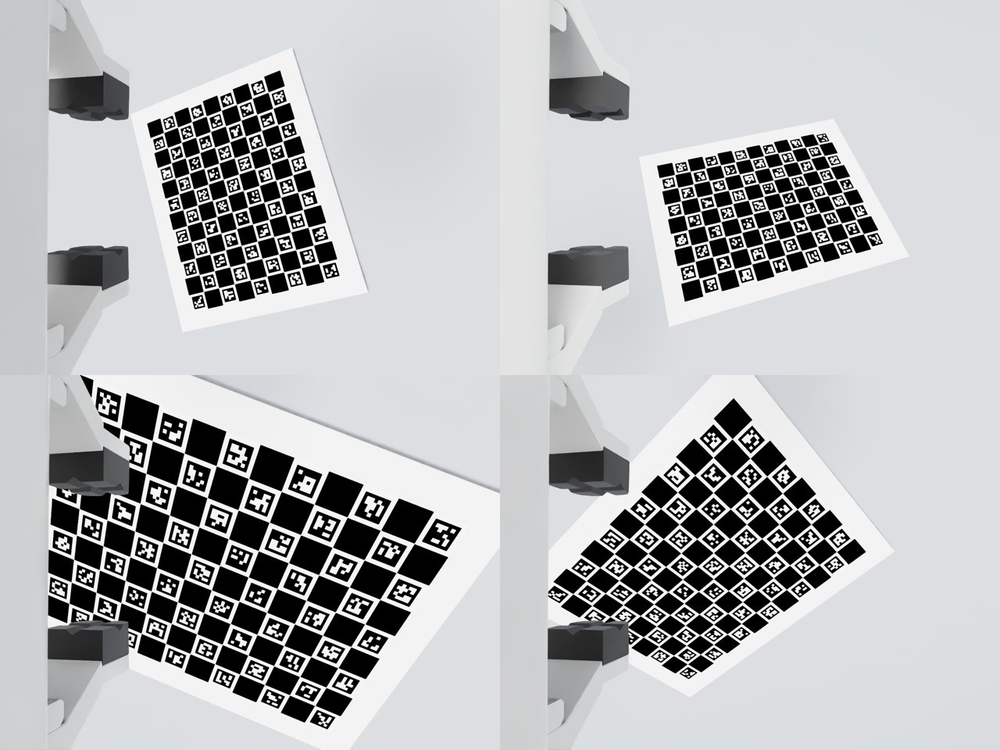
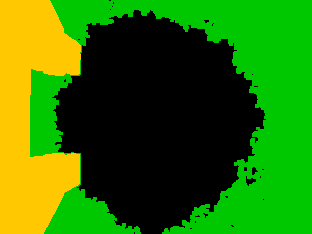

# 仿真验证报告

两组数据：

- **sim_charuco_seed0（主结果）**：相机朝夹爪倾斜 10°，夹爪挡住约 17.6% 的画面，标定板用 ChArUco。
- **sim_seed0**：相机正对、看不到夹爪，标定板用普通棋盘格。

两组的关节误差和刚度真值相同（seed 0）。下文先给 ChArUco 组的结果，后面是棋盘格组的完整记录。

## sim_charuco_seed0：夹爪遮挡下的标定

- **数据**：
  - 规划 300 个视角，298 个检测到标定板。
  - 每个视角可用的角点数：最少 25、中位数 67，总共 88 个。
  - 213 个视角用于训练，留出 75 个。
- **夹爪掩码**：从 60 张图像自动估计，阈值 100 灰度。
  - 覆盖了全部真实夹爪像素。
  - 另外还盖住了约 38% 的背景，这些区域标定板从来没有经过。
  - 被误删的已检测角点为 0.03%。
- **掩码的作用**：在这套渲染里，不加掩码也只有 1 个角点落在夹爪边缘 4 px 以内。标定结果用自动掩码、真值掩码、不用掩码三种方式都一样：留出误差都是 0.136–0.137 px。
- **真机上更要加掩码**：真实夹爪表面有纹理、反光，又有螺丝等细节，容易被误检成角点，所以掩码在真机上更重要。

| 模型 | 留出重投影 | 相机位置误差 均值/最大 | TCP 误差 均值/最大 | 闭环 IK 到达（60 次）均值 / p95 / 最大 |
|---|---:|---:|---:|---:|
| 标称运动学 + 手眼 | 3.48 px | 3.00 / 8.54 mm | 4.06 / 7.32 mm | 5.03 / 6.73 / 8.18 mm |
| + 几何误差 | 1.16 px | 2.46 / 8.87 mm | 1.87 / 7.77 mm | 1.48 / 3.04 / 4.81 mm |
| + 几何 + 柔性 | **0.137 px** | **0.029 / 0.090 mm** | 0.38 / 0.40 mm | **0.39 / 0.46 / 0.50 mm** |

刚度估计值与真值（N·m/rad）：

| 关节 | 2 | 3 | 4 | 5 | 6 |
|---|---:|---:|---:|---:|---:|
| 估计 | 5996 | 6977 | 5037 | 2627 | 2377 |
| 真值 | 6000 | 7000 | 5000 | 3000 | 2500 |

- **关节 1**：重力力矩约为 0，柔度保留在可辨识参数里，但估计值 1.0e-7、标准差 4.6e-5，与 0 不可区分，不可信。
- **留出残差**：0.137 px，比棋盘格组的 0.07 px 高。原因是 ChArUco 角点检测噪声更大（合成图上约 0.15 px），且角点的平均成像尺寸更小。精度没有下降：相机位置误差 0.03 mm，闭环误差相同。
- **TCP 误差**：仍是约 0.4 mm 的平移残差，原因和棋盘格组一样，见下文"剩余 0.37 mm 的 TCP 误差来自哪里"。

### 仿真中发现、已修复的问题

- **改动手和手指的 MassAPI 后，夹爪从渲染中消失。** 只要在 USD 里修改手、手指的 MassAPI，比如加负载、写转动惯量，物理步进后 RTX 渲染就不再显示夹爪。改法：只修改手臂连杆 1–7 的惯量；相机负载改成一个单独的刚体，用固定关节挂到手上。修改后实测力矩与带负载的重力模型吻合，RMS < 0.001 N·m。
- **无渲染的物理步进后，需要几次 `app.update()`。** 否则渲染出来的夹爪位姿是旧的。

---

# sim_seed0：棋盘格、无遮挡

## 设置

- **机械臂**：Isaac Sim 5.1 官方 Franka USD。7 个关节和法兰都写入了随机误差，关节平移 σ = 0.6 mm，旋转 σ = 0.15°（含零位）；法兰误差为 0。
- **关节刚度**：真值 K = [8000, 6000, 7000, 5000, 3000, 2500, 2000] N·m/rad，用 PhysX 关节驱动实现，重力下静平衡。末端负载 0.3 kg（相机支架）。
- **测量量**：编码器读数取驱动目标角，力矩取 `get_measured_joint_efforts`。
- **静平衡检查**：
  - 静平衡下 `K·Δq − τ` 的 RMS ≤ 0.18 N·m。
  - 最后 0.5 s 的漂移 ≤ 4.8e-7 rad。
  - 最大柔性变形：关节 2 为 7.9 mrad，关节 3 为 3.6 mrad，关节 4 为 4.4 mrad。
- **相机**：真实安装位置相对标称值偏了几毫米、约 1°。1280×960 RTX 渲染，fx = 924 px，无畸变。
- **棋盘格**：11×8 内角点、30 mm，平放在机械臂前方。
- **数据量**：300 个规划视角，其中 285 个检测到角点；213 个训练、72 个留出。15 个未检测到的视角都是大倾角（约 42–46°）或棋盘贴近图像边缘的情况。

## 留出视角精度（`scripts/evaluate_sim.py`）

| 模型 | 留出重投影 | 相机位置误差 均值/最大 | 相机姿态误差 | TCP 误差 均值/最大 |
|---|---:|---:|---:|---:|
| 标称运动学 + 手眼（`handeye`） | 2.77 px | 3.18 / 7.72 mm | 0.22° | 5.82 / 7.84 mm |
| + 几何误差（`geometry`） | 0.74 px | 2.14 / 4.10 mm | 0.20° | 1.91 / 3.96 mm |
| + 几何 + 柔性（`full`） | **0.070 px** | **0.016 / 0.036 mm** | **0.003°** | 0.37 / 0.39 mm |

`full` 的残差（0.07 px）已经接近渲染图像的角点检测噪声（约 0.05 px）。只标几何、不标柔性时，残差高出一个数量级。可见这里重力下的柔性变形不能被几何参数吸收。

关节刚度估计值与真值：

| 关节 | 2 | 3 | 4 | 5 | 6 |
|---|---:|---:|---:|---:|---:|
| 估计 | 5967 | 6823 | 4998 | 2834 | 2365 |
| 真值 | 6000 | 7000 | 5000 | 3000 | 2500 |

- 关节 1 和 7 的柔度辨识不出来，原因如下：
  - 关节 1：轴竖直，重力力矩约为 0。灵敏度只够勉强保留，估计值为负，且标准差与数值同量级，**不可信**。
  - 关节 7：力矩约为 0，已被固定。
  - 这两个关节没有重力负载，所以对实际精度几乎没有影响。
- 关节 5、6 的力矩只有约 1 N·m，变形不到 1 mrad，所以误差较大（5–6%）。关节 2、3、4 的误差在 0.1–2.5% 之间。

## 闭环 IK（`scripts/sim_ik_demo.py`，60 次）

每次实验的流程如下：

1. 取一个留出视角，用 PnP 加该模型估计棋盘在基座系下的位姿。
2. 用同一模型做 IK，让 TCP 停到某个角点正上方 2 cm，工具轴朝下，偏航角随机。
3. 在带误差的仿真机械臂上执行，从物理引擎读取 TCP 实际位置。

| 模型 | 均值 | RMS | p95 | 最大 |
|---|---:|---:|---:|---:|
| 标称运动学 + 手眼 | 6.67 mm | 6.74 | 8.83 | 9.73 |
| 几何补偿 | 1.96 mm | 2.07 | 3.27 | 3.54 |
| 几何 + 柔性补偿（URDF 重力模型） | **0.38 mm** | 0.39 | 0.45 | 0.49 |
| 几何 + 柔性补偿（实测力矩迭代 1 次） | 0.39 mm | 0.39 | 0.46 | 0.49 |

60 次 IK 全部收敛。

## 剩余 0.37 mm 的 TCP 误差来自哪里

这部分误差的来源是：真值关节 7 和法兰误差中有一部分只与"相机相对法兰"的位置耦合，相机观测不到，标定时被手眼外参吸收了。

- **手眼外参偏差**：估计的手眼外参与真实安装相差 0.45 mm / 0.23°。
- **相机位姿不受影响**：这个偏差对相机位姿完全不可见，相机误差只有 0.016 mm。
- **TCP 受影响**：TCP 在法兰另一侧 0.1 m 处，就带上了这部分误差。
- **验证**：假如相机相对手的安装真值已知，同样的模型得到的 TCP 误差均值是 0.015 mm，最大 0.031 mm。

**真机建议**：如果 TCP 精度要求高于这个量级，需要另外标定相机和 TCP 的相对位置。比如让 TCP 尖端触碰棋盘上的已知角点，同时用相机记录，作为额外约束。

## 过程中发现、已修复的问题

- **资产转动惯量过小，导致仿真无法静止。** Isaac 自带 Franka 资产的连杆转动惯量约 1e-6 kg·m²，比 URDF 小四个数量级。配上硬驱动后，部分位姿会出现持续振荡和关节 1 大幅偏移（`K·Δq − τ` 最大达 600 N·m）。改用 URDF 的转动惯量后，所有位姿都能静止。
- **articulation 休眠，导致没到平衡就被冻结。** 默认休眠阈值会在到达静平衡前冻结 articulation，已关闭。
- **IK 零空间项阻碍精确收敛。** 第一版 IK 的零空间项在阻尼下有泄漏，位置只能收敛到约 1.4 µm。同时 `geometry` 模式里有 4 次落到了另一个解支，误差几百毫米。改进后在接近收敛时关闭零空间项，失败时随机重启并选离参考位形最近的解，再没有失败。
- **像素中心约定差 0.5 px。** Isaac 渲染的像素中心约定与 OpenCV 差 0.5 px，被内参估计吸收了：cx = 639.46，cy = 479.50。

## 局限

这只是一组随机误差（seed 0）下的自洽验证，局限如下：

- **图像比真机理想**：渲染图像无噪声、无运动模糊、无镜头畸变，焦距恒定，棋盘绝对平整。
- **柔性模型是简化的**：柔性只用了理想线性扭簧，和标定模型完全一致。真机上的背隙、非线性刚度、连杆弯曲都会让残差变大。
- **真值动力学与标定所用一致**：仿真重力矩的真值和 URDF 质量模型相同。真机上这部分误差会传给"重力模型"补偿那一行；"实测力矩"补偿那一行不受影响。
